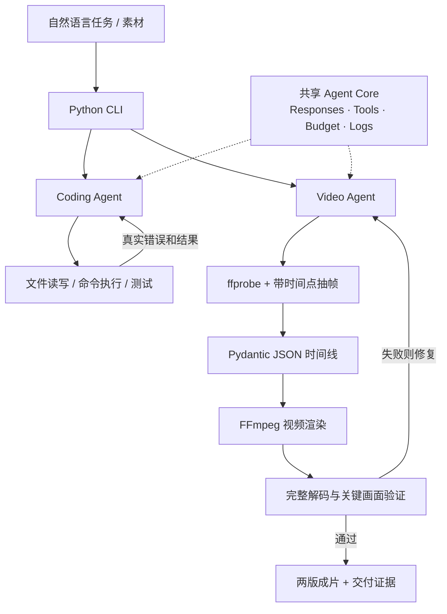

<div align="center">

# 🎬 Coding Agent × Video Agent

**让 Agent 自己写代码，也让 Agent 自己剪视频。**

<p>轻量 Python CLI · Responses 工具调用 · FFmpeg 确定性渲染 · 全流程可验证</p>


[快速上手](#-快速上手) · [技术架构](#-技术架构) · [必要配置](#️-必要配置) · [运行 Coding Agent](#-运行-coding-agent) · [验证与交付](#-验证与交付)

</div>

---

> **项目简介**：Coding Agent 通过文件工具和命令执行完成真实的编程、测试与错误修复；Video Agent 分析素材，将自然语言要求转换成 JSON 时间线，再由 FFmpeg 生成并验证视频。两者共享模型调用、预算、事件日志和检查点。
>
> 这是一个聚焦**自主执行、错误恢复、证据留存**的技术 Demo，不需要数据库、Web UI 或常驻后台服务。

> [!IMPORTANT]
> **当前模型配置是 DeepSeek Responses API**：`deepseek-flash` + `high`，官方端点 `https://api.deepseek.com`，只读取 `DEEPSEEK_API_KEY`。`openai` Python 包仅用作 Responses 协议客户端，**不表示实际调用 OpenAI 模型，也没有 Chat Completions 自动兼容层**。缺少指定密钥时会明确失败，不切换服务商。`runs/demo/` 保存的是迁移前的 OpenAI 历史记录。

## ✨ 项目亮点

| 能力 | Coding Agent | Video Agent |
| :-- | :--: | :--: |
| 自然语言任务与模型工具调用 | ✅ | ✅ |
| 实际执行、错误反馈与修复 | ✅ | ✅ |
| 文件变更与独立验收 | ✅ | — |
| 视频 / 图片 / 音频素材探测 | — | ✅ |
| 带时间戳的画面抽样分析 | — | ✅ |
| JSON 时间线、字幕、BGM、基础转场 | — | ✅ |
| 首次剪辑及 v1 → v2 追加修改 | — | ✅ |
| JSONL 日志、用量和可追溯证据 | ✅ | ✅ |

**核心原则：** 模型负责理解与决策，Python 负责约束校验，FFmpeg 负责视频渲染；**不能用模型的“成功”描述代替实际执行结果**。

## 🧩 技术架构



技术栈：**Python 3.12+、openai SDK、Pydantic、FFmpeg/ffprobe、Git、JSON/JSONL**。无需额外的 Agent 框架。

## 📦 环境与依赖

| 依赖 | 要求 / 版本 | 作用 |
| :-- | :-- | :-- |
| Python | **3.12+** | 主程序运行；仓库记录已在 Windows / Python 3.13.7 验证 |
| `openai` | **2.44.0** | DeepSeek Responses 的 SDK 客户端 |
| `pydantic` | **2.13.4** | 模型参数、配置和时间线校验 |
| FFmpeg / ffprobe | 推荐使用带 `libx264`、AAC、字幕滤镜和 `xfade` 的版本 | 抽帧、媒体探测、转场、字幕、混音与导出 |
| Git | PATH 可用 | 阶段提交和历史追溯 |
| 中文字体 | 默认 `C:/Windows/Fonts/msyh.ttc` | 中文标题和字幕 |
| DeepSeek API | 对当前模型和 Responses 能力有访问权限 | 编程、视觉理解与剪辑规划 |

`requirements.txt` 实际只有两个直接 Python 依赖：

```text
openai==2.44.0
pydantic==2.13.4
```

**FFmpeg、ffprobe 和 Git 必须单独安装，不能通过上述 pip 依赖自动获得。**目前预检脚本按 Windows 字体候选路径检查；Linux/macOS 还需要适配字体与预检，不能视为已验证环境。

## 🚀 快速上手

下面的命令针对 **Windows PowerShell**，从全新克隆到两版 10 秒演示视频。

### 1. 获取项目并安装依赖

```powershell
git clone https://github.com/fengjunziya/Tmp.git
cd Tmp

python -m venv .venv
.\.venv\Scripts\Activate.ps1
python -m pip install -r requirements.txt

python --version
git --version
ffmpeg -version
ffprobe -version
```

如果 PowerShell 禁止激活虚拟环境，可以直接用 `.\.venv\Scripts\python.exe` 执行下文的 Python 命令。

### 2. 设置模型密钥并运行预检

```powershell
$env:DEEPSEEK_API_KEY = "你的 DeepSeek API Key"

python scripts/preflight.py --check-model --output reports/env_check_local.json
```

预检检查 Python 包、Git、FFmpeg、ffprobe、编码器、字幕滤镜和字体；`--check-model` 还会进行**真实的模型请求**，因此可能产生 API 费用。仅检查本地环境时可省略该参数。

### 3. 生成测试素材并完成两版剪辑

```powershell
# 生成合成视频、静态图片和背景音乐（无需下载素材）
python scripts/make_demo_assets.py --output materials/demo

# v1：视频在前，图片在后
python video_agent.py create --assets materials/demo --request examples/request_v1.txt --run-dir runs/quickstart --config config.example.json

# v2：更换标题，并将图片移到视频之前
python video_agent.py revise --run-dir runs/quickstart --base-revision 1 --request examples/request_v2.txt --config config.example.json

# 按仓库演示要求做两版独立验收
python scripts/accept_video.py --run-dir runs/quickstart
```

| 预期产物 | 内容 |
| :-- | :-- |
| `runs/quickstart/output_v1.mp4` | 第一版：标题「十秒灵感」、动态视频 → 静态图片 |
| `runs/quickstart/output_v2.mp4` | 第二版：标题「让灵感再快一步」、静态图片 → 动态视频 |
| `timeline_v1.json`、`timeline_v2.json` | 两版 JSON 剪辑时间线 |
| `validation_v1.json`、`validation_v2.json` | 对应成片的独立验证结果 |
| `revision_diff.json` | 第二版相对第一版的修改与继承记录 |

演示需求规定：**10 秒、1280×720、30fps、MP4/H.264/AAC**，包含 500ms 交叉溶解、中文标题和结尾文字、原声及 BGM。详见 [首次需求](examples/request_v1.txt) 和 [修改要求](examples/request_v2.txt)。

> [!TIP]
> 你可以替换 `--assets` 指向的目录和 `--request` 文本文件来尝试自己的素材；但 `scripts/accept_video.py` 是**针对上述固定演示要求**编写的验收程序。自定义任务需要配套新的验收条件。

## 🧑‍💻 运行 Coding Agent

仓库附带一个可复现的编程修复练习：准备脚本生成**故意出错的** `calculator.py`，由 Coding Agent 先运行出真实失败，再修改代码并通过只读测试文件的验收。

```powershell
python scripts/prepare_coding_demo.py

python coding_agent.py run --task examples/coding_smoke.txt --workspace .local/coding_demo --run-dir runs/my_coding --config config.example.json --acceptance reports/coding_demo_acceptance.json --read-only test_calculator.py --allow-write calculator.py --allow-write sum_cli.py
```

**六个编程工具：** `list_files`、`read_file`、`write_file`、`replace_text`、`run_process`、`finish`。

独立验收文件使用命令参数数组，而不是模型自行声称完成：

```json
{
  "commands": [
    ["python", "test_calculator.py"]
  ]
}
```

准备脚本不会覆盖已有练习工作目录；重复实验应更换 `--workspace`。Coding Agent 还提供 `--resume`、`--follow-up`、`--max-turns` 和 `--total-timeout-s` 等参数，可运行 `python coding_agent.py run --help` 查看。

> [!WARNING]
> 允许写入列表与工作目录边界旨在减少误改文件，**不是不可信代码执行的完整安全沙箱**；请仅在适当隔离的工作区中运行。

## ⚙️ 必要配置

完整配置模板见 [config.example.json](config.example.json)。以下是当前可用的核心字段：

```json
{
  "model": "deepseek-flash",
  "reasoning_effort": "high",
  "api_key_env": "DEEPSEEK_API_KEY",
  "api_base": "https://api.deepseek.com",
  "api_retries": 2,
  "max_turns": 80,
  "request_timeout_s": 180,
  "command_timeout_s": 180,
  "total_timeout_s": 3600,
  "repair_rounds": 2,
  "ffmpeg": "ffmpeg",
  "ffprobe": "ffprobe",
  "font_path": "C:/Windows/Fonts/msyh.ttc",
  "output": { "width": 1280, "height": 720, "fps": 30 }
}
```

| 配置项 | 作用 |
| :-- | :-- |
| `model` / `reasoning_effort` | 代码校验固定 `deepseek-flash` / `high` |
| `api_base` / `api_key_env` | 固定官方端点和密钥环境变量，没有提供商回退 |
| `max_turns` / `total_timeout_s` | 单次 Agent 运行的调用轮数、总时限 |
| `api_retries` / `repair_rounds` | 短暂 API 错误重试及渲染修复预算 |
| `font_path` / `output` | 中文字体及默认导出尺寸、帧率 |
| `pricing` | 可选费用参数；未知单价和用量不会被当作零费用 |

**API Key 只从环境变量读取；项目不会自动加载 `.env`。**不要把真实凭据写进配置并上传 GitHub。修改非受限字段可复制配置模板，再通过 `--config 路径.json` 指定。

## 🗂️ 目录结构

```text
Tmp/
├── agent_core.py          # 共享模型调用、工具闭环、检查点、日志及预算
├── coding_agent.py        # Coding Agent 命令行入口
├── video_agent.py         # Video Agent 命令行入口
├── media.py               # 媒体探测和视觉观察
├── timeline.py            # JSON 时间线与约束校验
├── renderer.py            # FFmpeg 渲染
├── verify.py              # 视频输出验收
├── config.example.json    # 必要配置示例
├── requirements.txt       # Python 依赖版本
├── examples/              # 编程任务、剪辑 v1 / v2 要求
├── scripts/               # 环境预检、造素材、验收、打包和统计
├── tests/                 # 无网络单元测试
├── docs/                  # 需求与验收基线
├── materials/demo/        # 合成演示素材及清单
├── runs/                  # 执行日志、时间线、产物
├── reports/               # 运行、验收和费用记录
└── completion_report.txt  # 单页完成说明
```

一次视频运行会按版本保留 `assets.json`、`analysis.json`、`requirements_v1/v2.json`、`timeline_v1/v2.json`、`output_v1/v2.mp4`、`validation_v1/v2.json`、`revision_diff.json`、`events.jsonl`、`usage.json` 和 `manifest.json`。**v2 不覆盖已经验证通过的 v1。**

## ✅ 验证与交付

**无 API 消耗的单元测试：**

```powershell
python -m unittest discover -s tests -v
```

**两版视频实际验收：**

```powershell
python scripts/accept_video.py --run-dir runs/quickstart
```

**在保留全部历史素材与记录的原始交付工作目录中：**

```powershell
python scripts/summarize_delivery.py --run-dir runs/deepseek_video
python scripts/package_delivery.py --run-dir runs/deepseek_video --output delivery/Tmp_delivery.zip --include-history
```

打包脚本会校验要求的产物、历史目录、哈希与凭据泄漏，并可附带 Git bundle。它需要完整交付工作区，**不保证仅克隆 GitHub 源码就能打包已有历史视频**。

> [!NOTE]
> 仓库通过 `.gitignore` 排除了 `*.mp4`、`*.wav` 等大体积媒体和部分中间文件。`runs/deepseek_video/` 的文本证据可在仓库审阅；媒体文件需要在原始工作区或交付包获取，或按快速上手流程重新生成。`runs/demo/` 是历史 OpenAI 运行，不能误标为 DeepSeek 演示。

## 🔍 已知边界

- **支持：** 视频、图片、音频探测；定时抽帧；正常播放速度；pad/crop；原声增益；BGM；给定中文字幕；cut/fade/dissolve；v1 → v2 修改。
- **暂不支持：** 已配置可用的 ASR、自动对白字幕、复杂特效、变速、运动跟踪和图形界面。涉及转录的任务会明确失败，而不是生成虚构内容。
- **验证范围：** 输出规格、完整解码、时间线约束和采样画面可被检查；抽帧不能证明未采样区间每帧语义都正确。
- **费用和正式考核：** 原始模型用量可追溯；缺失用量、未核对的单价以及正式考核起止时间仍按未知或待确认记录，不声称全部考核项目通过。

**进一步阅读：** [需求与验收基线](docs/requirements.md) · [验收证据矩阵](reports/acceptance_summary.json) · [一页交付说明](completion_report.txt)

---

<div align="center"><sub>Small architecture. Real execution. Verifiable results.</sub></div>
